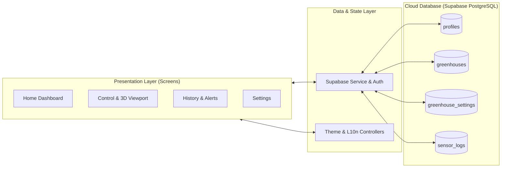

# Plantum — Smart Greenhouse Management App

**Plantum** helps private and small-scale greenhouse owners monitor microclimate parameters in real time, control irrigation and climate equipment remotely, and visualize greenhouse zones through an interactive 3D model and map integration.

---

## Target User & Problem

**Arman, 38**, owns a 24–60 m² backyard greenhouse in **Atyrau, Kazakhstan**, where he grows tomatoes and cucumbers across sharp seasonal temperature swings. Because he works full-time away from home, he cannot check soil moisture or air heat during the day, and sudden summer heat spikes or dry winds can damage crops within hours. He needs a clean, localized (`EN` / `RU` / `KZ`) mobile interface to monitor conditions at a glance and trigger watering or ventilation from anywhere.

---

## Extra Feature · Spatial & 3D Visualization Track

> **"Our app can display an interactive 3D model of the greenhouse alongside exact OpenStreetMap geolocation pinning because our user needs intuitive spatial awareness of their greenhouse layout, device placement, and site coordinates without complex technical blueprints."**

---

## Team & Roles

| Team Member | Role & Responsibilities |
| :--- | :--- |
| **Alizhan Zholzhanov** | Flutter application architecture, backend development, Supabase PostgreSQL schema, authentication, and real-time state synchronization |
| **Utezhan Kairmukhanbet** | Interactive 3D greenhouse modeling, spatial viewport integration, and technical/project documentation |
| **Alikhan Salimov** | UI/UX design in Figma, color palette, light/dark mode styling, and interactive prototype flows |
| **Anuar Kuanysh** | UI/UX component design in Figma, multi-language layout adaptation (`EN`/`RU`/`KZ`), and user flow testing |

---

## Design & Interactive Prototype

* **Figma Prototype:** [Open Plantum Interactive Prototype](https://www.figma.com/design/hgooDdtZhlYLJt7ei8P01D/Plantum-%E2%80%94-Core-Screens?node-id=0-1&t=Xo58JatpXx9pYxG7-1)
* **Logo & Visual Style:** Soft, nature-inspired minimalist interface designed to reduce eye strain during outdoor and indoor use:
  * **Background:** `#F8F9FA` (Light Mode) / `#121412` (Dark Mode)
  * **Cards & Surfaces:** `#FFFFFF` (Light Mode) / `#1C1F1C` (Dark Mode)
  * **Primary Accent:** `#2E7D32` Forest Green & `#E8F5E9` Soft Sage (`#9CCC65` Lime Green in Dark Mode)
  * **Typography:** Clean geometric sans-serif (`Inter` / `Plus Jakarta Sans`) with clear metric hierarchy.

---

## Core Modules (M1–M8)

* **M1 · Login:** Email/password sign-up, login, and logout via Supabase Auth with row-level security (RLS) isolating each user's greenhouse.
* **M2 · Dashboard:** Real-time cards for air temperature, air humidity, soil moisture, and grow light status with target ranges and status badges (`Norm`).
* **M3 · Control:** Remote toggles for Watering, Lighting, and Ventilation with database state updates and confirmation feedback.
* **M4 · Modes:** Manual override and automated threshold rules (e.g., activating irrigation automatically when soil moisture drops below target).
* **M5 · Alerts:** In-app notifications and warning indicators whenever microclimate readings leave safe min/max thresholds.
* **M6 · History:** 24-hour and multi-day microclimate bar charts displaying average temperature, humidity, and soil moisture trends.
* **M7 · Settings:** Custom min/max threshold sliders, Light/Dark theme switcher, greenhouse map preview, profile editing, and `EN` / `RU` / `KZ` language selector.
* **M8 · No Internet:** Graceful offline state handling with clear connection feedback and automatic data recovery when network returns.

---

## Tech Stack & Rationale

* **Flutter & Dart:** Chosen for cross-platform mobile development from a single codebase, delivering smooth 60fps UI performance, custom charts, and consistent Light/Dark theming across Android and iOS.
* **Supabase (PostgreSQL, Auth, Realtime, RLS):** Provides a managed cloud database, built-in user authentication, and strict Row-Level Security policies so each user accesses only their own greenhouse without maintaining a separate backend server.
* **OpenStreetMap (`flutter_map`) & 3D Model Viewer:** Enables lightweight, API-key-free geolocation pinning during greenhouse deployment alongside an interactive 3D greenhouse viewport.

---

## System Architecture & Data Flow

###What happens step-by-step when the user presses "Water"?
UI Event: The user taps the Watering toggle on the Control screen.

Data Layer Call: The service layer sends an asynchronous UPDATE request to Supabase targeting the active greenhouse's row in greenhouse_settings (watering_on = true).

Database & Security Check: Supabase verifies the user's JWT session via Row-Level Security (RLS) and commits the updated state to PostgreSQL.

UI Confirmation: Once confirmed, the switch updates its state and displays a confirmation toast ("Watering successfully activated").

Database Schema
profiles — Stores user account metadata (id, username, email, created_at) linked to auth.users.

greenhouses — Stores greenhouse metadata and coordinates (id, user_id, name, area_sqm, address, latitude, longitude, created_at).

greenhouse_settings — Stores target microclimate thresholds and live actuator states (id, greenhouse_id, temp_min, temp_max, humidity_min, humidity_max, soil_min, soil_max, watering_on, lighting_on, ventilation_on, grow_light_on, auto_mode).

sensor_logs — Stores current readings and historical telemetry logs (id, greenhouse_id, temperature, humidity, soil_moisture, recorded_at) for charts and threshold alerts.
